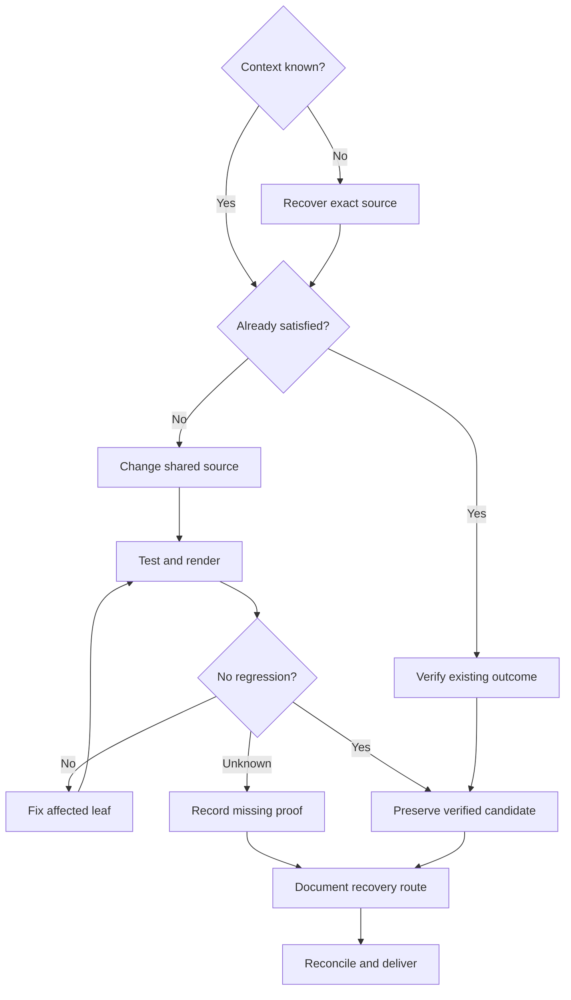

# ROJ-0017 — Playable Character Anatomy Refinement

**Authority:** [existing ROJ-0017 task in tracker](https://docs.google.com/spreadsheets/d/1aVbGKnYgGl9gDvI40BVXLOYSp5wGEcNAlSXALkj0s9Y/edit), original [character packet](https://docs.google.com/document/d/1dQaSDYmixYkBtmCTgQtNf8bnBHXA4BxGdCBcy8SBek0/edit). This is one dependency graph with fifty local subgoals, **not** new tickets. The ROJ-0013 combat candidates and separate 54-joint Blender production remain untouched.

## Source, comparison, and constraints

- Baseline: `main@a7ac2a72750f80dd78e7f100dd704819cf7e818a`; V2 32,424 vertices, 64,844 triangles, 22 bones and 16 clips. The specifically requested original PNG was not available; a locally generated **source-based baseline render** replaces it, accurately labeled as CPU Mesa/VTK, not Blender/WebGL/game capture.
- Candidate: V3 **shared** implicit surface used by `createArticulatedFighter` and `toAuthoringMesh` (`src/animation/anatomical-surface.js`). No duplicate master model. `anatomical-pose.js` remains presentation-only; `articulated-fighter.js` preserves its public API and head-bound eye meshes. Historical GLBs, source JSON, motion/world authority, collision, camera, `.github/workflows/**`, and NexusEngine are unchanged.
- Geometry: **35,656 vertices / 71,308 triangles** (**+9.97%** vs V2); 22 identical bone names; 16 source action names; spacing .0195 m vs .021 m. Exact geometry arrays represent ~3.28 MB before GPU/JS overhead. An isolated source construction took ~2.20 s on Node 22; repeated cache lookup 0.0145 ms. Full game frame-time/FPS **UNKNOWN**.
- Dominant differences: flatter pectoral barrel, more directional deltoid, continuous clavicle-to-thorax/hip, better posterior torso and calf profiles; shortened cheek/nose features, resized inset eye geometry; separated arm flexor/extensor contours, thumb web, foot arch/instep; bounded toe-off presentation. Head/hands remain stylized and coarse under close-up. **Visual anatomical approval not claimed.**
- The source was recovered through supported GitHub connector reads and verified against Git blob SHA-1 before local edits. Main and tracker must be reread before pushing; post-change CI evidence is distinct from the baseline run.

## Conditional dependency graph

Dependency route: context/permissions → silhouette/landmarks → torso/pelvis/limbs → face/digits → skin/poses → authoring/performance → main evidence. `UNKNOWN` is never a pass. Decomposition stops at an exact target, smallest proof, and recovery route, following Luminary Framework/DMT as an **organizational method**, not a validated internal LLM circuit.

## Evidence scope / execution state

- **SOURCE TESTED:** Node 22 `node --test tests/anatomy-refinement.test.mjs tests/anatomical-surface.test.mjs tests/articulated-fighter.test.mjs tests/anatomical-authoring.test.mjs`: 22 pass, 0 fail. Geometry tests include one closed welded surface, no non-manifold edges, normalized 4-bone weights, expected orientation, finite unit normals, four dependent interface tests and 16 source clips. The new test covers symmetric proportions, hip/shoulder/hand/foot landmarks, 16 names and toe-off bounds.
- **SOURCE RENDERED:** VTK 9.6 CPU Mesa PLY: matched front/three-quarter/side/rear, head/hand/foot detail, and unlit silhouettes. Baseline/candidate neutral eye overlays use the **exact geometry/scales of head-bound eyes in the corresponding Three adapter**, approximated in VTK; this remains **not actual WebGL**.
- **SOURCE-POSE QA:** 12 finite CPU linear-blend-skinned poses using the 22-bone rig and pure presentation pose. Raised-arm, crouch, walk, strike, head turn and wrist twist available as PLY; eyes intentionally omitted from posed snapshots because eye-parent attachment is not simulated by that CPU renderer. The first incorrectly overlaid eye pose images were discarded and regenerated correctly.
- **INCOMPLETE LOCAL REPOSITORY:** `npm run check` records 138 pass and 16 fail because the connector-recovered source omits pinned `three`/Nexus packages and historical binary GLBs; do not misclassify these as changes breaking CI. `npm run build -- --base=/Relics-of-Jotunheim/` has no local `vite`; `npm run author:unified` has no pinned Nexus package; `npm run verify:browser` has no local `playwright` dependency. Actual clean-build/native GLB/visual browser results **UNKNOWN** until a complete environment runs them. The existing deploy workflow owns package installation; it was read but not changed.
- **BLENDER KIT:** Luminary BlenderKit v0.0.4 recovered read-only from `LuminaryLabs-Dev/LuminaryLabs@eefbe17a775b6156fbdd5ee1171d79a99cd4aad6`, `.agent/plugins/blender-kit`, plus the 10-pass legacy ROJ production-kit rig/gait smoke test. Kit actions were inspected, 9 Python tests passed (2 Nexus-dependent skipped). **No Blender run or goal-mode execution**: `blender` absent; shared-drive Linux installer is 400,938,576 bytes and connector rejects transfers above 268,435,456; goal-loop requires missing sibling Nexus source. Do not call these renderings Blender files.
- **APPROVAL:** User will review code and appearance. Main delivery is not tied to an artificial browser-availability gate. Unproved anatomy aesthetics, true animated skin under WebGL, Blender checkpoint, export/reimport and deployment are separately represented.

## A01–A50 outcome leaves

For every row: condition → exact target/action → expected observable result; prerequisite → minimal proof → explicit status and recovery. All `renders/`, `qa/`, and `logs/` paths below refer to task-local sandbox evidence, **not committed binary GLBs**; the available preview package link is in the Sheets Evidence tab.

| ID | If condition | Exact target / action | Expected observable | Depends | Disposition | Smallest proof; recovery |
|---|---|---|---|---|---|---|
| A01 | Stylized target unknown | `ANATOMY proportions` | Keep 2.17 m, ~7.2 heads | 00 | **VERIFIED** | `qa/metrics.json`; Compare source silhouette and target |
| A02 | Bind landmark uncertainty | `anatomicalRig/ANATOMY` | Record shoulder, elbow, wrist, hip, knee, ankle | A01 | **VERIFIED** | `qa/metrics.json`; Remeasure if rest pose changes |
| A03 | Body widths unbalanced | `torso/arm/leg/head fields` | Taper waist and match shoulder/pelvis | A02 | **IMPLEMENTED** | `renders/candidate-v9-front.png`; Recompare widths before approval |
| A04 | Neutral pose unstable? | `anatomicalRig, pose.reset` | Preserve relaxed symmetrical rest | A02 | **ALREADY SATISFIED** | `tests/anatomical-surface.test.mjs`; Investigate runtime transform if different |
| A05 | Side depth too uniform | `torso depth SDF` | Give ribcage/pelvis differentiated depth | A03 | **IMPLEMENTED** | `renders/candidate-v9-side.png`; Review against side-profile anatomy |
| A06 | Spherical shoulders | `arm deltoid capsule` | Directional taper, smaller shoulder cap | A03 | **IMPLEMENTED** | `renders/candidate-v9-front.png`; Further shoulder sculpt if round |
| A07 | Clavicle slope absent | `torso clavicle capsule` | Sternum-to-acromion slope | A06 | **IMPLEMENTED** | `renders/candidate-v9-three-quarter.png`; Inspect raised arm continuity |
| A08 | Inflated pectorals | `torso thorax/pec field` | Remove separate chest balloons | A05 | **IMPLEMENTED** | `renders/candidate-v9-front.png`; Art-review flatter chest plane |
| A09 | Armpit pinch at elevation? | `arm/torso seam and weights` | Continuous raised-arm skin | A06,A08 | **IMPLEMENTED** | `renders/posed-raised-front.png`; WebGL skinned pose still required |
| A10 | Rear anatomy unseen | `torso lat/scapular masses` | Rear plane and shoulder transition | A07 | **IMPLEMENTED** | `renders/candidate-v9-rear.png`; Review scapula with light rotation |
| A11 | Rib/oblique seam plain | `torso abdomen and flank ellipsoids` | Soft oblique-to-waist transition | A05 | **IMPLEMENTED** | `renders/candidate-v9-three-quarter.png`; Improve side-plane separation |
| A12 | Upper/lower ab planes absent | `torso/abdomen SDF` | Natural two-plane abdomen | A11 | **BLOCKED** | `renders/candidate-v9-front.png`; Needs anatomy-approved sculpt; do not add fake abs |
| A13 | Pelvis narrow/disjoint | `torso iliac/gluteal union` | Coherent femoral socket volume | A03 | **IMPLEMENTED** | `renders/candidate-v9-three-quarter.png`; Check gait hip-clearance |
| A14 | Glutes/sacrum unresolved | `torso rear gluteal fields` | Rear sacral/glute shape | A13 | **IMPLEMENTED** | `renders/candidate-v9-rear.png`; Compare seated/crouch source |
| A15 | Groin/adductors abrupt | `leg adductor and pelvis blend` | Inner-thigh clearance | A13 | **IMPLEMENTED** | `renders/candidate-v9-front.png`; Inspect crouch for intersection |
| A16 | Cylindrical upper arms | `arm biceps/triceps fields` | Different front/back contours | A06 | **IMPLEMENTED** | `renders/candidate-v9-side.png`; Inspect twist under screen lighting |
| A17 | Elbow cuff visible | `arm elbow/capsule taper` | One continuous elbow silhouette | A16 | **IMPLEMENTED** | `renders/candidate-v9-front.png`; Check full elbow-flex |
| A18 | Forearm constant radius | `arm flexor/extensor fields` | Front/back taper to wrist | A17 | **IMPLEMENTED** | `renders/candidate-v9-side.png`; Check pronounced muscle bulges |
| A19 | Thumb/palm unclear | `arm palm, web, thumb` | Connected tapered thumb web | A18 | **IMPLEMENTED** | `renders/candidate-v9-hand.png`; Fingertip separation remains limited |
| A20 | Fingers equal/merged | `arm finger capsules` | Staggered roots, tips, lengths | A19 | **IMPLEMENTED** | `renders/candidate-v9-hand.png`; Requires local adaptive remesh for fine detail |
| A21 | Thighs homogeneous | `leg quadriceps/hamstring/adductor` | Front and rear thigh planes | A13 | **IMPLEMENTED** | `renders/candidate-v9-side.png`; Check lateral knee articulation |
| A22 | Patella as cuff | `leg knee ellipse` | Narrow anterior knee landmark | A21 | **IMPLEMENTED** | `renders/candidate-v9-front.png`; Check under deep crouch |
| A23 | Shin/calf same shape | `leg calf/shin fields` | Posterior calf, straight shin | A22 | **IMPLEMENTED** | `renders/candidate-v9-side.png`; Observe ankle flexion pose |
| A24 | Ankle/heel abrupt | `leg Achilles/heel blend` | Narrow tendon to planted heel | A23 | **IMPLEMENTED** | `renders/candidate-v9-foot.png`; Check dynamic ground contact |
| A25 | Feet too amorphous | `leg instep/forefoot/toes` | Tapered forefoot with toe gradient | A24 | **IMPLEMENTED** | `renders/candidate-v9-foot.png`; Requires more toe resolution |
| A26 | Head lower balance off | `head cranium/jaw union` | Adult forehead-to-chin proportions | A03 | **IMPLEMENTED** | `renders/candidate-v9-head.png`; Human facial art approval pending |
| A27 | Eyes/corners harsh | `head shallow orbit` | Reduce depth and cheek interference | A26 | **IMPLEMENTED** | `renders/candidate-v9-head.png`; Orbit still faceted; retopo needed |
| A28 | Large cheek wedges | `head malar ellipse` | Shallower symmetric midface | A26 | **IMPLEMENTED** | `renders/candidate-v9-head.png`; Review facial volume close-up |
| A29 | Jaw and chin abrupt | `head jaw/chin field` | Continuous lower face | A28 | **IMPLEMENTED** | `renders/candidate-v9-head.png`; Jaw angle still simplified |
| A30 | Neck-to-head continuity? | `torso neck/head smin` | Neck fused to skull | A26 | **ALREADY SATISFIED** | `tests/anatomical-surface.test.mjs`; Retest head-look extremes |
| A31 | Eyes too exposed | `articulated-fighter eye spheres` | Smaller head-bound eyes | A27 | **IMPLEMENTED** | `renders/candidate-v9-head.png`; Native eye material parity unknown |
| A32 | Nose tip inflated | `head nasal tip/bridge` | Less protuberant bridge/alar form | A28 | **IMPLEMENTED** | `renders/candidate-v9-head.png`; Refine nostril geometry in higher-res pass |
| A33 | Lips are color-only | `head lip SDF/material` | Subtle sculpted oral volumes | A32 | **BLOCKED** | `renders/candidate-v9-head.png`; Requires high-resolution facial sculpt and accepted mouth form |
| A34 | Ear too large | `head ear elliptical union` | Reduced ear projection | A26 | **IMPLEMENTED** | `renders/candidate-v9-side.png`; Inner helix detail not yet sculpted |
| A35 | Hair boundary uneven | `surfaceColor hair line` | Soft scalp-following line | A26 | **IMPLEMENTED** | `renders/candidate-v9-head.png`; Review hair colors on deployed renderer |
| A36 | Face/digits underresolved | `createAnatomicalSurface spacing` | Local resolution around features | A19,A27 | **BLOCKED** | `logs/candidate-tests-v5b.log`; Adaptive attempt reverted; develop watertight sculpt detail with measured budget |
| A37 | Joint retopology uncertain | `source surface near shoulder/elbow/hip` | Deformation-friendly loops | A36 | **BLOCKED** | `qa/pose-source-qa.json`; Needs retopology and live skinned motion checks |
| A38 | Normals quality unknown | `gradient field normals` | Finite unit normals and winding | A03 | **VERIFIED** | `tests/anatomical-surface.test.mjs`; Revalidate after any remesh |
| A39 | Cloth/hair edges jagged | `surfaceColor briefs/hairline` | Smoother boundaries | A35 | **IMPLEMENTED** | `renders/candidate-v9-front.png`; Some aliasing remains at pixel scale |
| A40 | PBR regions uniform | `surfaceColor/Three mesh material` | Differentiated cloth/skin/hair PBR | A39 | **BLOCKED** | `src/animation/articulated-fighter.js`; Requires coordinated native multi-material mapping and tests |
| A41 | Raise arm may collapse | `22-bone CPU skinning, arm weights` | Finite shoulder elevation | A09 | **VERIFIED** | `renders/posed-raised-front.png`; Browser skinned deformation and visual acceptance untested |
| A42 | Elbow/wrist twist unknown | `CPU skinning pose overrides` | Finite elbow flex and wrist twist | A17 | **VERIFIED** | `qa/pose-source-qa.json`; Inspect wrinkle/pinch in browser |
| A43 | Hip/knee joint intersections? | `CPU walk/crouch skinning` | Finite walk/crouch transforms | A15 | **VERIFIED** | `renders/posed-crouch-front.png`; Game camera/contact needs live browser |
| A44 | No toe-off presentation | `anatomical-pose toe rotation` | Bounded toe roll during late stance | A25 | **IMPLEMENTED** | `tests/anatomy-refinement.test.mjs`; Actual foot-plant and heel clearance unverified |
| A45 | Look extremes may deform | `head/neck skinned CPU poses` | Finite head turn without world writes | A27 | **VERIFIED** | `qa/pose-source-qa.json`; Test actual head-look integration in WebGL |
| A46 | No matched four-view evidence | `CPU Mesa/VTK source and eye adapter` | Front/3Q/side/rear/detail captures | A03 | **IMPLEMENTED** | `renders/ROJ-0017-source-before-after.png`; Browser/Blender captures remain unexecuted |
| A47 | Native export eye parity unknown | `author-unified-fighter.mjs` | GLB parity and clean reimport | A31,A48 | **BLOCKED** | `logs/npm-run-author-unified.log`; Acquire pinned Nexus dependency; run native export+reimport; inspect eyes |
| A48 | Clip names may regress | `canonical-v2-source, rig, author adapter` | All 16 required names retained | A04 | **VERIFIED** | `tests/anatomy-refinement.test.mjs`; Native exported clip parity still blocked |
| A49 | Performance not measured | `createAnatomicalSurface caching` | Geometry and build-cost metrics | A36 | **VERIFIED** | `qa/metrics.json`; Browser FPS and memory require real runtime |
| A50 | Main delivery not evidenced | `GitHub main + Tasks/Evidence` | Non-forced main commit and CI state | A46,A48 | **IMPLEMENTED** | `Google Sheets Evidence`; Read final main SHA, run and deployment; no approval assumed |

## Validation limits and recovery

1. Install the **pinned** NexusEngine checkout and Node 22 dependencies in a complete authorized runner, using only the documented temporary manifest compatibility workaround. Rerun `npm run check`, `npm run build -- --base=/Relics-of-Jotunheim/`, `npm run author:unified`, clean native reimport, and browser capture. Verify 22 bone names, all 16 clips, skin weights and head-attached eyes in the exported GLB. No dependency repin.
2. In an environment with actual BlenderKit + Blender binary, run documented check → bounded goal-mode worker → native `.blend` save → actual Cycles/Eevee render → GLB export/reimport → compare source. Keep any editable Blender master synchronized through an explicit proven adapter, never a second divergent master.
3. Run live head-look, sprint, landing, dodge and raised-arm camera tests. Resolve remaining close-up facial polygon planes, individual finger/toe resolution, material boundary aliasing and dynamic heel/toe/ground contact. Do not use world-motion or collision changes to hide geometry defects.
4. Update the existing ROJ-0017 task and Evidence tab with actual commit SHA, workflow run ID, evidence hashes and any failed/recovered gates. Source and deployment statuses must stay separate. Do not modify the ROJ-0013 Packet.
